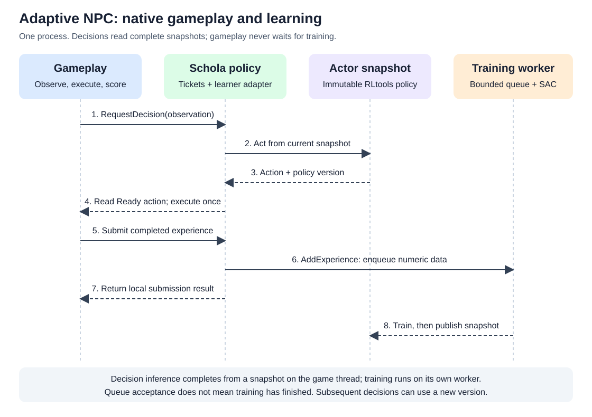

Adaptive NPC Online Learning: Native Integration
================================================

Adaptive learning runs inside the Unreal process using RLtools C++. Gameplay
reports outcomes to a native learner, which trains on a background thread and
publishes immutable actor snapshots for later decisions. This replaces the
earlier proposal for a separate Python/SB3 adaptive service; no adaptive RPC
client, service handshake, delivery retry, or remote acknowledgement is needed.
Schola's existing Python tooling for other training workflows is unchanged.

Current components and boundaries
---------------------------------

The repository contains two native learning examples and a shared policy API:

.. list-table:: Existing components
   :header-rows: 1
   :widths: 30 70

   * - Component
     - Responsibility and current scope
   * - ``UAdaptiveNPCPolicy``
     - Shared decision/experience validation, decision tickets, identity checks, expiry,
       cancellation and episode/session lifecycle in ``ScholaInferenceUtils``.
       The base class owns no learner and rejects decision dispatch.
   * - ``UOnlineSACPolicy``
     - Native adapter in ``Examples/AdaptiveSAC/Source/OnlineSACSchola``.
       Creates a local RLtools SAC learner, completes decisions from its actor
       snapshot, and supplies learner admission for the shared ``SubmitExperience`` call.
   * - ``OnlineSACRuntime``
     - Engine-neutral learner and chase simulation in
       ``Examples/AdaptiveTag/Source/OnlineSACRuntime``. The AdaptiveSAC host
       compiles the same sources through thin wrapper files.
   * - ``TagLearningRuntime``
     - The original tag example's custom categorical actor-critic. It learns
       LEFT/RIGHT route preferences directly through its game integration and
       remains separate from the SAC adapter.

``UNPCInferencePolicy`` still has a mock Adaptive selection. It does not
delegate to ``UOnlineSACPolicy``. Its preferred-action ``SubmitFeedback`` API
does not represent completed reinforcement-learning experience. Use the
dedicated adaptive policy's ticket API for native learner decisions; existing
paradigms and steppers retain their own behavior.

Local gameplay and learning loop
--------------------------------

         an immutable RLtools actor snapshot. Gameplay executes the action and
         submits its outcome through the adapter to the learner queue. A worker
         trains on accepted experience and publishes a later actor snapshot.
   :width: 100%

   All components run in one process. Training runs separately from gameplay.

1. **Initialize the native policy.** Base ``Init`` validates and copies the
   interaction definition. The subclass constructs its learner and calls
   protected ``StartSession`` with a fresh session GUID and valid agent/episode
   IDs once the learner is ready. Base initialization alone is not readiness.
2. **Request a decision.** Gameplay calls ``RequestDecision`` with an observation.
   The base validates it and tracks a ticket. ``UOnlineSACPolicy`` calls ``Act``
   on the current actor snapshot and completes the ticket synchronously with
   the action and snapshot version. It does not wait for a training round.
3. **Execute the returned action once.** Gameplay reads ``TryGetDecision``,
   applies a Ready action, and retains its identifying fields. Repeated Ready
   polls return copies; gameplay tracks whether the action has been applied.
4. **Submit the completed outcome.** Gameplay supplies the originating
   observation, executed command, reward, next observation, episode-ending
   flags and original identity in ``FAdaptiveExperience``. The common policy
   validates the active session and numerical data. The SAC adapter maps
   the command back to the learner's normalized action range and calls
   ``AddExperience``. The learner uses a bounded input queue.
5. **Train and publish later.** The worker stores experiences and performs SAC
   updates, then publishes a complete actor snapshot. Later decisions can use
   its new version. Queue acceptance is not proof of an optimizer update or
   improved behavior.

All policy UObject calls belong on the game thread. Training operates on owned
numeric data and must not access game actors. Deferred decision completions,
if a subclass uses them, return to the game thread with weak policy ownership
and the original request identity. The current SAC adapter does not need a
deferred completion to read its snapshot.

Test-only waits can make simulator runs reproducible. Do not wait for the
learner on the live game thread; ``ChaseSession`` must use ``lockstep = false``
when driven by a real-time game. The policy calls ``Act`` and ``AddExperience``
directly rather than driving ``ChaseSession::Step``.

Records, actions and episode boundaries
---------------------------------------

The shared Unreal records are defined in ``Policies/AdaptiveLearningTypes.h``:

* ``FAdaptiveDecisionRequest`` copies the observation and session, agent,
  episode and decision IDs assigned by the policy.
* ``FAdaptiveDecision`` adds the returned action and nonnegative snapshot
  version. Valid results may come from an older snapshot.
* ``FAdaptiveExperience`` describes the original decision's actual outcome,
  including a finite reward and separate ``bTerminated`` / ``bTruncated`` flags.

Session IDs identify local learner sessions. Episode resets preserve learning
while cancelling old actions and advancing the episode ID. Decision IDs are
never reused within a policy object's lifetime. Capture the final observation
and submit the last experience before resetting an ended episode.

``ExecutedAction`` is the command applied by gameplay, not measured displacement
or an unrelated fallback. The SAC adapter maps actions between Schola's declared
Box bounds and the learner's ``[-1, 1]`` range in both directions. Observations,
rewards and episode flags must retain the simulation's meanings.

The shared ``UAdaptiveNPCPolicy::SubmitExperience`` call returns
``EAdaptiveSubmitResult``: ``Accepted``, ``Rejected``, ``Dropped``, ``Frozen``
or ``NotReady``. ``Accepted`` means local queue admission;
``Dropped`` reports a full queue. Gameplay must submit each outcome once: the
current adapter does not implement experience deduplication or automatic retry.
The base records are passive containers and do not submit or validate outcomes.

The call requires a Ready session, its current session GUID, a nonnegative policy
version, a finite reward, and finite Box observations/actions matching the declared
dimensions, shapes and bounds. Common validation runs before the protected
``DispatchExperience`` learner hook. The base hook returns ``NotReady`` because
it owns no learner; a native subclass overrides it to admit a validated record.
Subclasses copy any data retained after the call. ``GetLastError`` explains
rejection, queue-full and unavailable-learner results; Accepted and Frozen clear
old errors. Decision/agent/episode fields remain attribution data; this call does
not add per-decision history or duplicate detection.
Learner statistics count records that reach the learner; common validation
failures are reported by the return value and ``GetLastError``.

Existing limits and next integration work
-----------------------------------------

Current integration limits:

* The Schola SAC adapter still uses ``OnlineSACLearner`` (six observations, two
  actions). ``chase_sim`` uses ``ChaseLearner`` (eight observations, two actions).
  Moving the adapter and its tests to the eight-value learner is separate work.
* Base ``Shutdown`` invalidates the session. The current SAC subclass requires
  ``ShutdownLearner`` or destruction to stop its learner immediately; making
  base shutdown stop a subclass learner is a separate lifecycle change.
* The AdaptiveSAC host targets UE 5.8 with the full Schola plugin, including
  ``ScholaMass``. UE 5.7 and cross-version compatibility are deferred.
* Policy tests are provided in the host; recorded learner/simulator results
  alone do not establish that the Schola policy integration tests pass.

See ``Examples/AdaptiveSAC/README.md`` for host setup and
``Examples/AdaptiveTag/Evidence/SAC/README.md`` for learner results and limits.
Checkpoint work is not yet merged, and adaptation after a runner-pattern switch
has not been established for the current chase simulator. The original tag
learner's matched learning-versus-frozen experiment is a separate result.

Verification boundaries
-----------------------

The ``Schola.Inference.Adaptive`` tests establish base validation and ticket
lifecycle behavior using controlled native responses. See
:doc:`adaptive_policy_setup` and :doc:`adaptive_decision_lifecycle`.

The AdaptiveSAC host's ``ScholaOnlineLearning.SAC.Policy`` tests exercise the
native adapter. Establish inference, experience reaching the learner, published
updates and safe lifecycle behavior through that path before claiming a tested
integration. Demonstrating adaptation additionally requires a matched frozen
comparison under changed runner behavior; changed weights alone are insufficient.
