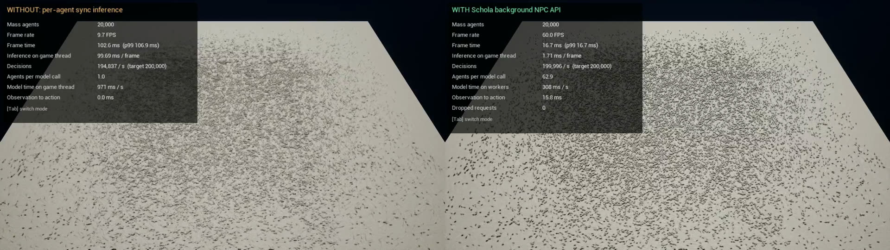

# Advanced NPCs for AMD Schola

## About the project

Schola is an AMD toolkit that connects Unreal Engine environments and agents to reinforcement learning tools. Our project explores advanced NPC behavior within that ecosystem.

The adaptive NPC work focuses on **continued learning during gameplay**. Instead of freezing an NPC's behavior after training, we want it to improve its decisions from new gameplay experiences and respond when player habits change.

For D2, the adaptive work demonstrates a **native Unreal Engine + RLtools prototype**: a tagger learns which route to favor while a player or scripted runner tries to escape. Training runs inside the game process without a Python service. Schola integration remains future work for this prototype.

The background NPC work focuses on **scaling ML-controlled agents within a frame budget**. Schola's inference API can now batch decisions from many Actors or Mass entities and run them on worker threads, so the game thread never waits for the model. For D2, the [comparison example](Examples/BackgroundNPCs/README.md) shows a 20,000-agent Mass crowd with and without the API.

The event-based NPC work focuses on allowing NPCs to perform inference in response to explicit gameplay events rather than continuously evaluating decisions every frame. This is particularly useful for turn-based games and event-driven interactions, where NPCs only need to make decisions when relevant gameplay conditions change. For D2, we implemented a prototype Event Stepper in Unreal Engine that supports a triggered inference. 

### Other project features

| Subteam / feature | Description and value |
| --- | --- |
| Efficient background agents | Batched, non-blocking inference for large populations of ML-controlled Actors and Mass entities. The game thread submits observations and applies actions on a later frame. Background workers run the ONNX policy in batches. Researchers can scale agent counts and decision rates without the model running inside the frame. |
| Shared Policy NPC inference | A reference ONNX model batches observations from multiple NPCs and supports role-specific Combat and Support outputs. Unreal-side bindings associate each NPC with a head, while the Shared Policy Stepper collects observations and routes returned actions. The reference model and Unreal routing infrastructure are implemented separately; real NNE integration and performance evaluation remain future work. |

## Access the D2 product

| Item | Location |
| --- | --- |
| Course repository | [9-AMD-Advanced-NPCs](https://github.com/csc301-2026-f/9-AMD-Advanced-NPCs) |
| D2 release and download | |
| Adaptive NPC source | [Examples/AdaptiveTag](Examples/AdaptiveTag/README.md) |
| Demo recording | |
| Background NPC comparison source | [Examples/BackgroundNPCs](Examples/BackgroundNPCs/README.md) |
| Background NPC side-by-side recording | [background-npc-side-by-side.mp4](deliverables/D2/evidence/background-npc-side-by-side.mp4) |
| Background NPC API guide | [NPC inference paradigms: Background NPCs](Docs/Sphinx/guides/mock_inference_paradigms.rst) |
| Shared Policy prototype | [Source, tests, and instructions](Prototypes/SharedPolicy/README.md) |
| Shared Policy implementation PRs | [ONNX prototype PR #5](https://github.com/csc301-2026-f/9-AMD-Advanced-NPCs/pull/5), [head bindings PR #7](https://github.com/csc301-2026-f/9-AMD-Advanced-NPCs/pull/7), and [Stepper PR #13](https://github.com/csc301-2026-f/9-AMD-Advanced-NPCs/pull/13) |
| Shared Policy planning | [Project guide](https://docs.google.com/document/d/1QPLZo8vqCXEwkyKr5YaowDqcifTEvgNM/edit) |
| Shared Policy presentation | [D2 slide deck](https://docs.google.com/presentation/d/1oCS74S7zQehjbKYZ9ql0jUwtF_QFhtFMUqCipEH-tRk/edit) |

**Current availability:** the repository includes the standalone Unreal project, arena assets, and pinned RLtools headers under `Examples/AdaptiveTag`. You can build and run the simulation from a clone using the instructions below. A downloadable D2 package, independent-machine check, and final release URL still need confirmation.

### Clone and play locally

On Windows, install Unreal Engine **5.7** and Visual Studio 2022 with the **Game development with C++** workload and a Windows SDK. The prototype was tested with Unreal 5.7.4. No separate host repository, Python service, or downloaded model is needed.

```powershell
git clone https://github.com/csc301-2026-f/9-AMD-Advanced-NPCs.git
cd 9-AMD-Advanced-NPCs/Examples/AdaptiveTag
./Play-TagArena.ps1 -Build -Paused
```

The script discovers Unreal, builds the project, and opens the game paused. Click the window and press **Space** to begin. The first build can take several minutes. For an Unreal installation that is not registered with Epic Launcher, pass `-EnginePath 'C:/Epic/UE_5.7'` or set `UE_ENGINE_ROOT` to your engine root.

See the [prototype README](Examples/AdaptiveTag/README.md) for troubleshooting, optional native tests, and packaging.

### Run the adaptive NPC demo

Once the Windows package is available from the D2 release:

1. Download and extract the **whole package**, keeping `CSC301Host`, `Engine`, and `CSC301Host.exe` together. Copying only the executable is insufficient.
2. Open `CSC301Host.exe` from the extracted `Windows` folder.
3. Click the game window. If the arena is paused, press **Space**.
4. Use **WASD** to move the cyan runner around the left or right side of the central cover and reach the escape area. Avoid the red tagger.
5. Watch the actor's LEFT/RIGHT probabilities, scored outcomes, and training update count in the game display.

The packaged demo does not require a Python server or a local Unreal Editor installation. We have tested it on the development machine. Fresh-machine graphics/runtime prerequisites still need verification before distributing it as the D2 build.

After packaging, the executable is under `Examples/AdaptiveTag/Saved/TagLearning/Package/Windows/`. From `Examples/AdaptiveTag`, this command opens the package paused:

```powershell
./Play-TagArena.ps1 -Packaged -Paused
```

### Observe learning and adaptation

1. Press **T** to start with fresh weights and scores. The actor begins at 50% LEFT and 50% RIGHT.
2. Press **2** to select a runner that chooses the left route 80% of the time. If paused, press **Space**.
3. Let multiple rounds complete. The learner should develop a preference for LEFT. Individual outcomes are random, so its probabilities can fluctuate.
4. Press **3** to make the runner favor RIGHT. **Do not press T between these phases:** the point is to observe the same model adapting to new behavior.
5. Watch the probability trend move toward RIGHT and compare the recent catch rate over multiple rounds.

Press **F** to cycle through 1x, 4x, and 12x simulation speed when using an automated runner. Faster simulation produces more real arena rounds per minute. It does not invent training outcomes. Press **1** to return to human control.

### Controls

| Key | Action |
| --- | --- |
| WASD | Move the runner in human mode |
| 1 | Human runner |
| 2 | Automated runner with an 80% left preference |
| 3 | Automated runner with an 80% right preference |
| 4 | Automated runner with a balanced preference |
| Space | Pause or resume the arena |
| F | Cycle simulation speed |
| L | Freeze or resume learning while the actor continues choosing actions |
| B | Switch between the learner and an explicitly labelled fixed 50/50 comparison policy |
| R | Restart the current round without scoring it |
| T | Reset model weights, scores, and random streams |

Changes to the runner mode preserve the learned weights. Fresh launches and **T** reset them. Models currently remain in memory only.

### Instructions for other features

| Feature | Access and steps | Expected result |
| --- | --- | --- |
| Background NPC comparison | Build and run [Examples/BackgroundNPCs](Examples/BackgroundNPCs/README.md) (see [setup](#background-npc-comparison)). It starts with the background API enabled. Press **Tab** to switch to per-agent synchronous inference and back. | 20,000 Mass agents walk toward goals, steered by the ONNX policy. The HUD shows frame rate, frame time, game-thread inference time, decisions per second, agents per model call, and action latency for the active mode. |
| Shared Policy ONNX reference prototype | Follow the setup and execution commands in [Prototypes/SharedPolicy/README.md](Prototypes/SharedPolicy/README.md). The prototype requires Python 3.12 and `uv`. | The test suite reports 11 passing tests. The demo processes two NPC observations in one ONNX Runtime call and selects the Combat output for one row and the Support output for the other. This verifies the reference contract outside Unreal; it does not verify NNE integration. |

## Key use cases

### Adaptive NPC: learn a player's route preference

**User story:** As a game developer, I want an NPC to adjust its decisions from gameplay outcomes so that it can respond to changing player habits.

**D2 result:** a working native sandbox proof of concept. The actor controls the tagger's LEFT/RIGHT decision from the first round. The game executes movement and detects catches and escapes.

The tagger commits to a route before the runner commits. A catch earns **+1**, and an escape earns **-1**. One scored round produces one training experience and one update. Aborted rounds and idle timeouts do not train the model.

The actor currently receives a constant observation, **`[1.0]`**. It cannot see the runner's position, chosen route, or scripted bias. Its weights learn a general route preference from rewards. This is a deliberately small learning task rather than learned navigation.

### Adaptive NPC: continue learning after behavior changes

The scripted runner can switch its preference without resetting the learner. Later decisions use updated actor weights. Learning happens during the same gameplay session, with training on a background worker.

This is online reinforcement learning: the policy learns from fresh interactions as play continues. A fixed policy can perform well against one consistent runner, so the useful demonstration is adaptation after the runner changes its behavior.

### Adaptive NPC: inspect and compare behavior

The display shows action probabilities, recent experiences and rewards, training counts, and runtime statistics. **L** lets the tester freeze learning, and **B** selects a fixed comparison policy. These controls support inspection; a controlled learning-versus-frozen performance study remains future work.

### Efficient background agents: batch inference across many agents

**User story:** As a researcher, I want to batch inference requests across many background agents, including agents managed through Unreal's Mass Entity framework, so that I can study large-scale interactions between ML-controlled agents while staying within the simulation's performance budget.

**Description:** Running a policy once per agent on the game thread makes every frame wait for every model call. The cost grows with agent count and decision rate. The background NPC API instead collects due agents' observations into rows, batches compatible rows into shared buckets, and runs them on dedicated worker threads. Actions are applied on a later frame. The game thread only gathers and applies rows; it never waits for a model call. The same scheduler serves ordinary Actors (`UBackgroundStepper`) and Mass entities (`ScholaMass` processors), and Blueprint users can submit and poll requests directly.

**Implemented functionality:**

- A bounded batching scheduler with configurable workers, batch size, pending-row and byte limits, dispatch strategies, cancellation, and action-age expiry. Over capacity, it rejects work as Busy rather than queueing without limit.
- `UNNEBatchBackendProvider` (ORT CPU or BasicCpu), giving each worker its own model context. Typed row encoding covers Box, Discrete, and flat Dict spaces.
- **Actor integration:** `UBackgroundStepper` phases agents by decision rate and applies results only when they are still current. Agents can write rows directly with `INPCBackgroundRowAgent`.
- **Mass integration:** `UScholaMassGatherProcessor` and `UScholaMassApplyProcessor` base classes, schedule/state fragments, a shared bucket fragment, and a signal for immediate decisions. The `ScholaMass` module depends only on the engine's Mass runtime modules.
- Statistics for real model calls, rows per call, rejections, expiry, and worker time, available from C++ and Blueprint.

**Demo and validation:** [Examples/BackgroundNPCs](Examples/BackgroundNPCs/README.md) runs the same Mass crowd **without** the API (each due agent makes its own batch-1 `RunSync` call on the game thread) and **with** it. The scene, ONNX policy, observations, decision schedule, and movement code are identical; only the inference path changes. [Watch the side-by-side recording](deliverables/D2/evidence/background-npc-side-by-side.mp4). Without the API is on the left; with the API is on the right.

[](deliverables/D2/evidence/background-npc-side-by-side.mp4)

Measured with `Scripts/compare.sh` on one Linux machine (Ryzen 5 7600X, Radeon RX 7800 XT, UE 5.8.3 packaged Development build, Vulkan, 1280×720). The workload was 20,000 Mass agents, each deciding 10 times per second (200,000 decisions/s), with a 60 FPS cap. Each mode ran in its own process: 10 s warm-up, then 30 s measured. [Raw reports](deliverables/D2/evidence/background-npc-comparison.md).

| Metric | Without API (per-agent sync) | With background NPC API |
| --- | ---: | ---: |
| Frame rate | 10.4 FPS | 60.0 FPS (at cap) |
| Mean / p99 frame time | 95.5 / 101.2 ms | 16.7 / 16.7 ms |
| Game-thread inference per frame | 93.0 ms | 1.6 ms |
| Decisions per second | 199,272 | 199,979 |
| Agents per model call | 1 | 62.9 |
| Inference time per second of play | 970 ms (game thread) | 327 ms (summed over 2 workers) |
| Observation-to-action latency | ≈0 ms | 15.8 ms (about one frame) |
| Dropped requests | 0 | 0 |

Both modes make the same number of decisions. Without the API, the model calls take about 97% of game-thread time, so the frame rate falls to about 10 FPS. With the API, the game thread spends 1.6 ms per frame gathering and applying rows, and the frame stays at the 60 FPS cap. Batching also cuts total model time to about a third. The trade-off is that actions arrive about one frame after their observation. The synchronous baseline's time includes writing observations. The policy is a synthetic steering network, so these results show frame cost, not behavior quality. With the frame cap removed in shorter smoke runs, the API mode reached about 325 FPS and the per-agent mode stayed near 10 FPS.

### Shared Policy NPCs: batch role-specific inference

**User story:** As a game developer, I want multiple NPCs to share compatible
inference work while selecting outputs for their assigned roles, so that I can
support specialized NPC behaviour without running an unrelated complete model
design for every agent.

**Description:** The Shared Policy investigation explores how Schola could
collect observations from several NPCs, process them as a tensor batch, and
route each returned action according to the NPC's configured role. The initial
reference architecture uses one shared layer with named Combat and Support
outputs. Following AMD feedback, the team is also considering role-conditioned
policies, batching NPCs separately by role, and separate backbone and head
models.

**Implemented functionality:**

- A deterministic PyTorch reference model with one shared layer and two named
  outputs.
- Dynamic-batch ONNX export with `observations`, `combat_actions`, and
  `support_actions` tensors.
- A two-NPC ONNX Runtime example that performs one inference call and preserves
  request order while selecting each NPC's configured output.
- Eleven Python tests covering shapes, metadata, exact values, routing order,
  runtime call count, malformed observations, and invalid model contracts.
- Unreal-side NPC-to-head bindings with configuration validation and lookup
  utilities.
- A Shared Policy Stepper that collects NPC observations, calls the
  `ISharedPolicy` batch interface, and routes returned actions to the
  corresponding NPCs.

**Demo and validation:** [PR #5](https://github.com/csc301-2026-f/9-AMD-Advanced-NPCs/pull/5)
and the [prototype instructions](Prototypes/SharedPolicy/README.md) contain the
reference implementation, reproduction commands, expected output, and tests.
[PR #7](https://github.com/csc301-2026-f/9-AMD-Advanced-NPCs/pull/7) and
[PR #13](https://github.com/csc301-2026-f/9-AMD-Advanced-NPCs/pull/13) contain
the Unreal configuration and Stepper work. The Python and Unreal components
have not yet been connected through a real NNE policy, and no production
performance claim has been made.

### Connected product workflow

**Start-to-finish user journey:**

**Connections between subteam features:**

**Acceptance evidence:**

## Adaptive NPC implementation

The current learner is a small **custom categorical actor-critic** built with RLtools' C++ neural network, backpropagation, and Adam optimizer operations. It does not use RLtools' built-in SAC or PPO training loop.

| Component | Role in this demo |
| --- | --- |
| Actor | Produces LEFT/RIGHT probabilities and samples the tagger's route |
| Critic | Predicts expected reward and provides a reference for evaluating the actual outcome |
| Experience | Records the observation, actor action, chosen-action probability, reward, and policy version |
| Training worker | Updates the networks and publishes complete actor copies for later decisions |
| Unreal arena | Handles runner input, movement, collision, rewards, and the display |

The actor and critic each have two hidden layers of 16 neurons. The actor learning rate is **0.006**, the critic rate is **0.003**, and the entropy weight is **0.4**. Entropy regularization encourages the actor to retain some uncertainty. The actor's selected action passes directly to the game without a random-action override or random warmup.

The numeric learner owns its training data and networks. It does not access Unreal objects from the training thread. Gameplay uses complete actor snapshots, and shutdown joins the worker before destroying its owner.

### Validation results

These are recorded development test results, not performance guarantees for other environments or hardware.

A separate fresh checkout passed the native tests, Unreal editor and game builds,
packaging, 26 arena checks, and nine packaged learning checks without copying
project binaries, caches, or the old plugin junction. This used the same Windows
development machine and installed Unreal/C++ tools, rather than a fresh machine.

| Check | Recorded result | Evidence |
| --- | --- | --- |
| Native learner across four seeds | All four adapt to both runner preferences | [Native test output](deliverables/D2/evidence/adaptive-native-tests.txt) |
| Packaged Unreal learning test | All 9 checks pass, with 512 scored experiences and 512 updates | [Packaged test report](deliverables/D2/evidence/adaptive-packaged-test.json) |
| Actor control | Every tagger route matches the actor's returned action in the packaged integration test | [Packaged test report](deliverables/D2/evidence/adaptive-packaged-test.json) |
| Arena input, movement, collision, and pause | All 26 checks pass | [Arena smoke report](deliverables/D2/evidence/adaptive-arena-smoke.json) |

In the packaged test, the same model completed **256 rounds against each runner bias**:

| Stage | Probability of choosing LEFT |
| --- | ---: |
| Fresh model | 50.0% |
| After the left-biased phase | 92.7% |
| After switching to the right-biased phase | 1.7% |

These values describe the actor's probabilities, not catch rates. The test preserved the weights across the switch. The final 64-round catch rate was **75%**.

The native and packaged learning results use the current actor rate of 0.006. The arena smoke test covers unchanged game behavior from before that learning-rate adjustment.

### Current limitations

- The prototype runs independently of Schola. Its API integration remains to be designed and implemented.
- It learns one route decision per round from a constant observation. Movement and interception execution are scripted.
- Learning depends on collecting enough scored rounds. Faster computation alone does not provide more experience.
- Models do not persist across launches.
- Testing establishes this small task. Larger agent counts, frame-time budgets, richer observations, and controlled comparisons need further evaluation.

### Other principal components

**User interface / developer experience:**

**Backend / API structure:**

**Tests and known limitations:**

## Background NPC implementation


| Component | Location | Role |
| --- | --- | --- |
| Scheduler | `Source/ScholaInferenceUtils/.../BackgroundInferenceScheduler.*` | Admits rows within pending limits, assembles batches, dispatches them to workers, and tracks request status and statistics |
| Policy and subsystem | `UNPCInferencePolicy` (`Paradigm = Background`), `UNPCBackgroundInferenceSubsystem` | Configures the scheduler and shares one reference-counted bucket per compatible model, schema, and settings in a world |
| NNE backend | `Source/ScholaNNE/.../NNEBatchBackendProvider.*` | Creates one ORT CPU or BasicCpu model context per worker and binds rows to model tensors |
| Actor adapter | `UBackgroundStepper`, `INPCBackgroundRowAgent` | Schedules Actor agents by decision rate, submits due rows, and applies current results |
| Mass adapter | `Source/ScholaMass` | Gather/apply processor bases, schedule and state fragments, a bucket shared fragment, and the `ScholaDecideNow` signal |

For Mass, derive a gather processor that writes observation rows and an apply processor that consumes action rows. Give entities the `FScholaInferenceScheduleFragment`, `FScholaInferenceStateFragment`, and a `FScholaInferenceBucketFragment` from `UScholaMassInferenceSubsystem::AcquireBucket`. [`CrowdProcessors.cpp`](Examples/BackgroundNPCs/Source/BackgroundNPCs/CrowdProcessors.cpp) is a complete example. The [API guide](Docs/Sphinx/guides/mock_inference_paradigms.rst) covers the Actor and Blueprint paths.

### Current limitations

- Actions arrive at least one frame after their observation. Results older than `MaxActionAgeMs` (100 ms by default) are discarded, and the agent keeps its previous action.
- Execution is CPU-only (ORT CPU or BasicCpu). GPU execution has not been integrated.
- The comparison policy is a synthetic network that steers agents toward goals. It demonstrates frame cost, not behavior quality. The measurements come from one Linux machine.
- The Mass gather processor's `MaxRowsPerFrame` must not exceed the scheduler's `MaxPendingRows` (both default to 4,096). A larger submission is rejected as Invalid on every frame, and no decisions are made.
- Synchronous `Think`/`BatchedThink` remain available for compatibility and still block the caller.
- Earlier diagnostics left Actor-adapter pool growth unresolved (see [individual contributions](deliverables/D2/Individual_Contributions_Deliverable2.md#max)).

## Event-based NPCs implementation

- Created **UEventStepper**, implementing Schola's **IStepper** interface.
- Added initialization support for agents and their associated inference policy.
- Implemented **TriggerInference()** to initiate the inference process.
- Integrated Schola's observation, inference, and action execution flow: **Observe → BatchedThink → Act**
- Connected the Stepper to an Unreal Engine Blueprint demonstration using a simulated gameplay event.
- Demonstrated an NPC responding to the trigger through visible movement in the Unreal environment.

### Current limitations:

- Gameplay events are manually connected to the Stepper rather than automatically subscribed to (So multiple event-based subscriptions and unsubscriptions are a work in progress)
- The demonstration uses a test policy and hardcoded movement in the agent's **Act** implementation rather than model-controlled movement.
- The current demonstration validates the basic event-triggered execution flow, not a complete production-ready Event NPC system.
- Compatibility issues with newer versions of Unreal and other NPCs. 

## Development requirements and setup

### Adaptive NPC sandbox

The current development environment uses Windows, **Unreal Engine 5.7.4**, Visual Studio 2022 with the C++ toolchain and Windows SDK, and CMake 3.20+ for the standalone native tests. These tools are for development rather than playing the packaged demo.

RLtools is pinned to revision `b32d9985c65a5e098a6bbf190fd994962d288b99`, and its headers and license are included in the repository. `Prepare-LearningDemo.ps1` validates the dependency and can restore a missing dependency directory. Schola stays disabled in this prototype, and training needs no Python backend.

The following commands run from **`Examples/AdaptiveTag` inside this repository**:

```powershell
./Prepare-LearningDemo.ps1
./Build.ps1
./Test-Learning.ps1 -Mode Native
./Test-TagArena.ps1
./Test-Learning.ps1 -Mode Arena
./Package-LearningDemo.ps1
./Test-Learning.ps1 -Mode Packaged -Executable ./Saved/TagLearning/Package/Windows/CSC301Host.exe
./Play-TagArena.ps1 -Packaged -Paused
```

The build, launch, packaging, and Unreal test scripts discover the installed engine. They also accept `-EnginePath` for a custom location. `UE_ENGINE_ROOT` provides an alternative to passing the argument repeatedly.

| Location within `Examples/AdaptiveTag` | Contents |
| --- | --- |
| `Source/TagLearningRuntime` | Native numeric learner and training worker |
| `Source/CSC301Host/TagArena*` | Arena, input, and display |
| `ThirdParty/RLtools` | Pinned dependency and license notice |
| `Tools/LearningTests` | Standalone native learning checks |
| `Learning-Demo.md` | Detailed play, learning, build, and test guide |
| `Evidence/FasterActor` | Current learning reports and recorded transitions |
| `Saved/TagLearning/Package/Windows` | Locally generated standalone game |

### Installing Schola Into Your Project

For the existing Schola plugin's installation and Python tooling, use [the Schola setup guide](README-Schola.md). The adaptive tag prototype runs independently of that plugin setup.

Gameplay writes experience and telemetry CSV files beneath the packaged game's `CSC301Host/Saved/TagLearning` directory. New sessions overwrite those files, so copy them before starting another recording session if you need to retain them.

### Background NPC comparison

**Prerequisites:** Unreal Engine 5.8 with the bundled NNERuntimeORT plugin. The example was built, packaged, and measured on Linux with UE 5.8.3, `clang`, and Vulkan. Recording also needs X11, `ffmpeg`, and `xdotool`. The Windows steps below have not been tested.

**Setup and run steps** (from `Examples/BackgroundNPCs`):

```bash
export UE_ENGINE_ROOT=/path/to/UnrealEngine-5.8.3
Scripts/build.sh      # links Plugins/Schola to this repository and builds the editor target
Scripts/run.sh        # play; Tab switches between the API and per-agent synchronous inference
Scripts/package.sh    # standalone Development game in Saved/Package/Linux
Scripts/compare.sh    # measures both modes and writes Saved/Comparison/summary.md
Scripts/record.sh     # records both modes and writes Saved/Recording/side-by-side.mp4
```

On Windows, run `New-Item -ItemType Junction -Path Plugins/Schola -Target ../../..` once in `Examples/BackgroundNPCs`, then open `BackgroundNPCs.uproject`. Use `-Agents=`, `-DecisionHz=`, `-MaxFPS=`, `-Workers=`, and `-MaxBatch=` to change the workload; see the [example README](Examples/BackgroundNPCs/README.md).

**Validation commands:** the plugin's automation tests cover the scheduler, NNE backend, Actor stepper, and Mass bridge:

```bash
"$UE_ENGINE_ROOT/Engine/Binaries/Linux/UnrealEditor-Cmd" "$PWD/BackgroundNPCs.uproject" -nullrhi -unattended -nosound \
  "-ExecCmds=Automation RunTests Schola.Inference.Background+Schola.Mass;Quit" "-TestExit=Automation Test Queue Empty"
```

On the development machine, all 43 `Schola.Inference.Background` and `Schola.Mass` automation tests passed from the example project (UE 5.8.3, Linux).

### Other subteam development setup

**Prerequisites:**

**Setup and run steps:**

**Validation commands:**

## Deployment and GitHub workflow

The adaptive prototype has repeatable build, test, and packaging scripts under `Examples/AdaptiveTag`. Its source, map, materials, and pinned dependency are versioned together in this repository. Generated binaries and caches remain ignored. The packaged game still needs a published D2 release location.

Existing Schola development conventions are documented in [CONTRIBUTING.md](CONTRIBUTING.md).

**Team branch and pull request workflow:**

**Review and merge requirements:**

**Release and deployment process:**

**Fresh-machine validation and runtime prerequisites:**

## Licensing

The existing Schola codebase carries an MIT license in [LICENSE.txt](LICENSE.txt). RLtools also uses the MIT license. The adaptive sandbox retains the RLtools notice and stages it with the packaged demo.

**Team license choice and rationale:**

## Remaining work and priorities

Proposed next steps for the adaptive NPC experiment are to compare learning and frozen actors under the same runner behavior changes, introduce useful observations and richer decisions, and design the Schola integration after evaluating the native approach.

Proposed next steps for background agents are to validate the comparison example on Windows, run it with a trained policy, measure scaling with more workers and larger crowds, and resolve the Actor-adapter pool growth. GPU execution would be added only if CPU workers become the bottleneck.

Extend Event NPCs with configurable gameplay event subscriptions and unsubscriptions.

**Team MVP priorities:**

**Owners and milestones through D4:**

**Cross-subteam dependencies:**

## Iteration review and partner feedback

See the [Iteration 02 review](deliverables/D2/iteration-02-review.md) for the online learning and background NPC reflections, and space for the other subteams.

**Online learning demo:** We shared a video demo of the adaptive tag game with the partner and are currently waiting to hear back.

**Background NPC demo:** We shared the [side-by-side recording](deliverables/D2/evidence/background-npc-side-by-side.mp4) of the Mass crowd without and with the background API along with the adaptive tag video, and are waiting for feedback.

**What worked well:**

**What did not work well:**

**Changes for the next iteration:**

**Partner demo date and participants:**

**Partner feedback and resulting decisions:**

## Individual contributions

| Student | Role | Specific contributions and PR / commit links |
| --- | --- | --- |
| Jace | Created the adaptive tag game and explored online learning integration options. | [Detailed contributions](deliverables/D2/Individual_Contributions_Deliverable2.md) |
| Max Xu | Implemented batched background NPC inference with Actor/Mass support; researched and benchmarked scheduling and CPU/GPU execution strategies; built the with/without-API Mass comparison example. | [PR #6](https://github.com/csc301-2026-f/9-AMD-Advanced-NPCs/pull/6), [comparison example](Examples/BackgroundNPCs/README.md), [detailed contributions](deliverables/D2/Individual_Contributions_Deliverable2.md#max) |
| Clementine | Implemented Unreal-side Shared Policy NPC bindings and the Shared Policy Stepper, and developed the interactive Streamlit demonstration. | [PR #7](https://github.com/csc301-2026-f/9-AMD-Advanced-NPCs/pull/7), [PR #13](https://github.com/csc301-2026-f/9-AMD-Advanced-NPCs/pull/13), and [detailed contributions](deliverables/D2/Individual_Contributions_Deliverable2.md#clementine) |
| Hiu Yan (Jaela) Kwok | Investigated Schola's inference architecture, authored the Shared Policy project plan, implemented and tested the ONNX reference prototype, and prepared the D2 presentation materials. | [PR #5](https://github.com/csc301-2026-f/9-AMD-Advanced-NPCs/pull/5), [prototype documentation](Prototypes/SharedPolicy/README.md), and [detailed contributions](deliverables/D2/Individual_Contributions_Deliverable2.md#hiu-yan-jaela-kwok) |
| Prithvi | Implemented the initial Event-based NPC inference prototype for AMD Schola. Developed UEventStepper to support explicitly triggered inference using the existing agent and policy interfaces, integrated the observation–inference–action pipeline, and built an Unreal Engine Blueprint demonstration showing an NPC responding to a simulated gameplay event.|
| | | |

## D2 submission checklist

The README supports the product demonstration. The iteration review and individual contribution document are separate required deliverables.

| Required item | Owner | Location / confirmation |
| --- | --- | --- |
| Root `README.md` with final access links and completed team sections | | |
| `deliverables/D2/iteration-02-review.md` | | |
| `deliverables/D2/Individual_Contributions_Deliverable2.md` | | |
| Stable deployed product and GitHub release tagged `D2` | | |
| Partner demonstration and feedback | | |
| One team submission linking the D2 release on Quercus | | |
